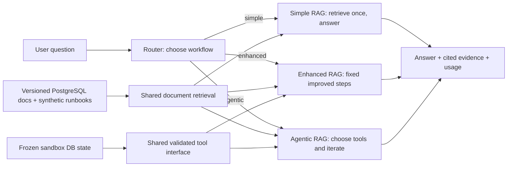
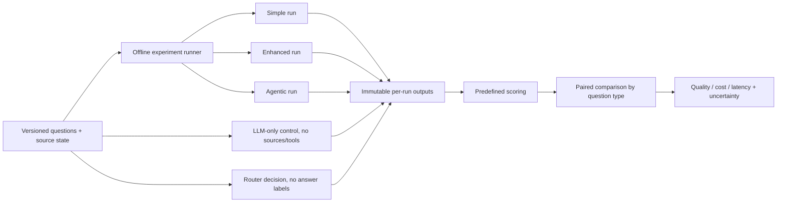

# Method-level design — first draft

**Status:** Working draft, 2026-11-01. The owner approved the PostgreSQL
docs/synthetic-runbook pilot and prior-knowledge controls. The exact workflow,
router, and final thesis protocol remain proposed. The supervisor liked the
Agentic RAG direction and requested a method-level design; this diagram has
not been reviewed by the supervisor. See [project context](PROJECT_CONTEXT.md)
for confirmed decisions and [status](STATUS.md) for completed work.

**Language decision (owner, 2026-11-05):** All RAG corpus documents,
questions/datasets, prompts, answers, model-visible tool descriptions and
evaluation text will be in English. Multilingual/cross-lingual support is
not a requirement; the remaining model and experiment choices stay open.

## Working research question

For which question types does dynamic Agentic RAG control justify its extra
cost and latency, and can a router choose among simple, enhanced, and agentic
workflows while maintaining acceptable answer quality?

The wording, quality margin, dataset, and primary comparison remain TBD.

## Proposed system method

**Definitions to fix before implementation:**

| Workflow | Proposed behavior | Relevant boundary |
| --- | --- | --- |
| Simple | One document retrieval, then answer or abstain. | No live-data tool; its failures on tool-only questions are a capability limit. |
| Enhanced | Predetermined retrieval improvements and conditional tool steps; no open-ended loop. | Must have the same relevant tool interface as agentic for the fixed-versus-dynamic comparison. Exact steps TBD. |
| Agentic | LLM chooses document/tool calls and may iterate after observations. | Set call, latency, and stopping limits before testing. |
| Router | Uses only information available when choosing a workflow. | Its cost, latency, and routing mistakes count in the routed policy. Algorithm TBD. |

## Proposed experiment method

1. Prepare the approved PostgreSQL docs/synthetic-runbook pilot and at least
   one meaningful non-retrieval DB tool. Exact version, coverage, and tool
   contracts remain open. Freeze document and DB-state versions for each
   test question so all workflows face the same facts.
2. Build manually verified questions with answer and required evidence. Cover
   direct document lookup, multi-document reasoning, live-tool lookup,
   document-plus-tool reasoning, and unanswerable cases. Keep development and
   frozen final-test questions separate. The [pilot scope](PILOT_SCOPE.md)
   contains 20 development records: P01–P06 now have a
   [source-verified subset](../data/evaluation/dev/README.md), while P07–P20
   remain drafts. This does not finalize the protocol or held-out set.
3. Use shared ingestion, retriever, tool implementation, and primary generator
   settings where comparable. Record workflow-specific differences explicitly.
4. For offline comparison, run **all three workflows on every test question**.
   Separately record the router's choice based on permitted input signals.
   Report always-simple, always-enhanced, always-agentic, and routed outcomes.
   The router must not see held-out expected answers or the other workflows'
   outputs when making its choice.
5. Score answer quality against a verified answer or rubric, evidence use,
   appropriate tool use, latency, token usage, monetary cost, and failures.
   Include router overhead. Report results overall and by question type.
6. Include the owner-approved LLM-only control, source-specific scenarios,
   changed-evidence pairs, and insufficient-evidence checks described in the
   evaluation plan. These controls do not add a fourth router target. Keep
   LLM-only-correct questions; report tool-access limitations separately.

This is an **offline study design**, so running all three arms is part of the
experiment. A deployed router would execute only the selected arm. The
routed-policy calculation must include its real decision overhead.

## Evaluation rules to specify before the frozen test

See the [evaluation protocol draft](EVALUATION_PLAN.md) for candidate metric
definitions and per-run fields.

- Primary answer-quality measure, judging protocol, and acceptable difference
  from the always-agentic policy.
- Exact cost accounting: LLM input/output, router, paid tool calls, and any
  other billed components; local compute should be reported separately if used.
- Latency measurement boundaries and handling of retries, timeouts, and failed
  calls.
- Per-question/run IDs, corpus and live-state versions, model IDs/settings,
  prompts, tool configuration, timestamp, and raw outputs needed to reproduce
  each aggregate table.
- Paired comparisons and uncertainty estimates suitable for the final sample
  size. Negative and mixed outcomes are valid results.

## Open decisions

The initial pilot embedding choice is now [pinned local Nomic](EMBEDDING_SETUP.md)
with a document/query smoke check. This does not finalize the study's generator,
judges or model-quality comparisons.

PostgreSQL documentation version/coverage, sandbox fixtures and tool contracts,
exact enhanced workflow, router implementation, models, final question counts,
quality margin, metric definitions, and the supervisor's preferred diagram
format. The 20-question pilot draft does not fix the final sample size.
