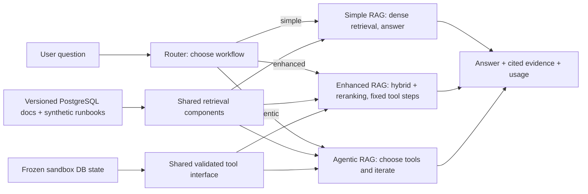
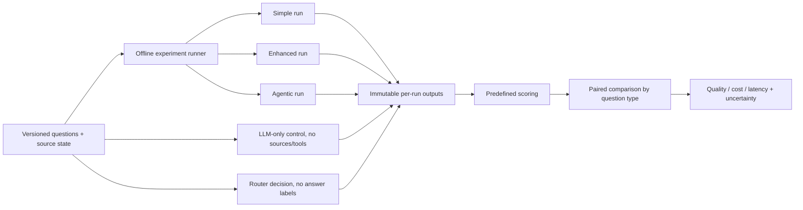

# Method-level design — first draft

**Status:** Working draft, updated 2026-11-17. The owner approved the initial
Simple/Enhanced design below, PostgreSQL docs/synthetic-runbook pilot and
prior-knowledge controls. Agentic details, the router and final thesis protocol
remain open. The supervisor liked the
Agentic RAG direction and requested a method-level design; this diagram has
not been reviewed by the supervisor. See [project context](PROJECT_CONTEXT.md)
for confirmed decisions and [status](STATUS.md) for completed work.

**Language decision (owner, 2026-11-05):** All RAG corpus documents,
questions/datasets, prompts, answers, model-visible tool descriptions and
evaluation text will be in English. Multilingual/cross-lingual support is
not a requirement; the remaining model and experiment choices stay open.

## Working research question

For which question types does dynamic Agentic RAG control justify its extra
cost and latency, and can a router choose among simple, enhanced, and agentic
workflows while maintaining acceptable answer quality?

The wording, quality margin, dataset, and primary comparison remain TBD.

## Proposed system method

| Workflow | Initial behavior | Decision status |
| --- | --- | --- |
| Simple | One dense retrieval pass, then answer or abstain. No hybrid search, reranking or sandbox tools in the initial baseline. | Implemented; live P01–P06 completed on 2026-11-17. Editorial review found four answers meeting recorded requirements and P03/P05 partial; broader controls remain. |
| Enhanced | Dense + PostgreSQL full-text retrieval, RRF merge/deduplication, reranking, then answer. Relevant tool steps follow predefined Python conditions/order. | Initial design approved, 2026-11-13; models, budgets and exact tool conditions remain open. |
| Agentic | Shared relevant tool access; the model chooses actions from observations within limits. | General direction retained; detailed design deferred until that stage. |
| Router | Chooses a workflow using permitted input signals. | Proposed; designed after fixed workflows and Agentic. |

## Approved initial Simple and Enhanced design

**Owner decision, 2026-11-13:** These are the project's initial operational
definitions, not universal meanings of the labels or a frozen thesis protocol.
Further additions can be considered explicitly later.

- **Simple document path:** question → Nomic dense retrieval using cosine
  distance → context → one final-answer LLM call.
- **Enhanced document path:** question → dense retrieval and PostgreSQL
  full-text search → merge ranks with Reciprocal Rank Fusion (RRF),
  deduplicating by chunk ID → rerank candidates → context → one final-answer
  LLM call. The sequence is predefined rather than selected by an LLM.
- **Shared controls:** same corpus/snapshots, chunks, dense embedding
  model/revision/settings, selected generator/settings, answer prompt and
  maximum context token budget. Both return source citations and may report
  insufficient evidence. Retrieved passages can differ; the shared budget
  does not imply identical actual context lengths.
- **Enhanced tools:** relevant sandbox operations are planned in addition to
  document retrieval. Python workflow code determines their conditions and
  order. Native LLM function calling is not required for this initial design;
  there is no model-directed tool loop. Tool contracts, arguments and branch
  conditions still need definition and must use permitted runtime inputs,
  never evaluation gold labels. Existing synthetic-runbook/DB-state plans remain.
- **Agentic later:** retain comparable relevant tool interfaces for the future
  fixed-versus-dynamic comparison, but defer graph, planning and loop details.
  No tool/workflow is implemented by recording this design.

During development, measure dense-only, hybrid-only and hybrid-plus-reranking
conditions in sequence to distinguish component contributions. These are
development ablations, not additional primary RAG workflows. Reranker model,
candidate counts, fusion parameters, final context limits and final generator
settings remain open. Luna is the initial client; choose/version final settings
on development data before final testing.

Technical basis: pgvector documents combining dense retrieval with PostgreSQL
full-text search and [rank fusion](https://github.com/pgvector/pgvector#hybrid-search).
Sentence Transformers describes the subsequent
[retrieve-and-rerank stage](https://www.sbert.net/examples/sentence_transformer/applications/retrieve_rerank/README.html).
These capabilities support implementation; they establish no quality result
for this corpus and no novelty claim.

## Proposed experiment method

1. Prepare the approved PostgreSQL docs/synthetic-runbook pilot and at least
   one meaningful non-retrieval DB tool. Exact version, coverage, and tool
   contracts remain open. Freeze document and DB-state versions for each
   test question so all workflows face the same facts.
2. Build manually verified questions with answer and required evidence. Cover
   direct document lookup, multi-document reasoning, live-tool lookup,
   document-plus-tool reasoning, and unanswerable cases. Keep development and
   frozen final-test questions separate. The [pilot scope](PILOT_SCOPE.md)
   contains 20 development records: P01–P06 now have a
   [source-verified subset](../data/evaluation/dev/README.md). P07–P09/P19 now
   have a separate verified Atlas subset, including an unanswerable case;
   P10–P18/P20 remain drafts. This does not finalize the protocol or held-out set.
3. Use shared ingestion, retriever, tool implementation, and primary generator
   settings where comparable. Record workflow-specific differences explicitly.
4. For offline comparison, run **all three workflows on every test question**.
   Separately record the router's choice based on permitted input signals.
   Report always-simple, always-enhanced, always-agentic, and routed outcomes.
   The router must not see held-out expected answers or the other workflows'
   outputs when making its choice.
5. Score answer quality against a verified answer or rubric, evidence use,
   appropriate tool use, latency, token usage, monetary cost, and failures.
   Include router overhead. Report results overall and by question type.
6. Include the owner-approved LLM-only control, source-specific scenarios,
   changed-evidence pairs, and insufficient-evidence checks described in the
   evaluation plan. These controls do not add a fourth router target. Keep
   LLM-only-correct questions; report tool-access limitations separately.

The first six-question Simple/LLM-only development comparison is recorded in
[LLM_ONLY_COMPARISON](LLM_ONLY_COMPARISON.md). Its descriptive findings do not
settle the final judging protocol or establish retrieval's causal contribution.

This is an **offline study design**, so running all three arms is part of the
experiment, outside live user traffic; it may call hosted APIs. A deployed
router would execute only the selected arm. The
routed-policy calculation must include its real decision overhead.

## Evaluation rules to specify before the frozen test

See the [evaluation protocol draft](EVALUATION_PLAN.md) for candidate metric
definitions and per-run fields.

- Primary answer-quality measure, judging protocol, and acceptable difference
  from the always-agentic policy.
- Exact cost accounting: LLM input/output, router, paid tool calls, and any
  other billed components; local compute should be reported separately if used.
- Latency measurement boundaries and handling of retries, timeouts, and failed
  calls.
- Per-question/run IDs, corpus and live-state versions, model IDs/settings,
  prompts, tool configuration, timestamp, and raw outputs needed to reproduce
  each aggregate table.
- Paired comparisons and uncertainty estimates suitable for the final sample
  size. Negative and mixed outcomes are valid results.

## Open decisions

The initial pilot embedding choice is now [pinned local Nomic](EMBEDDING_SETUP.md)
with a document/query smoke check. This does not finalize the study's generator,
judges or model-quality comparisons.

PostgreSQL documentation version/coverage, sandbox fixtures and tool contracts,
Enhanced tool conditions/budgets and reranker choice, detailed Agentic design,
router implementation, generator/judge models, final question counts,
quality margin, metric definitions, and the supervisor's preferred diagram
format. The 20-question pilot draft does not fix the final sample size.
